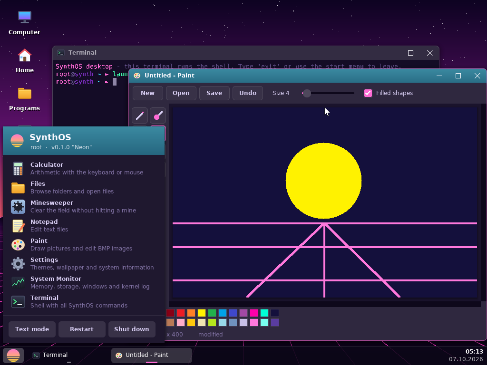
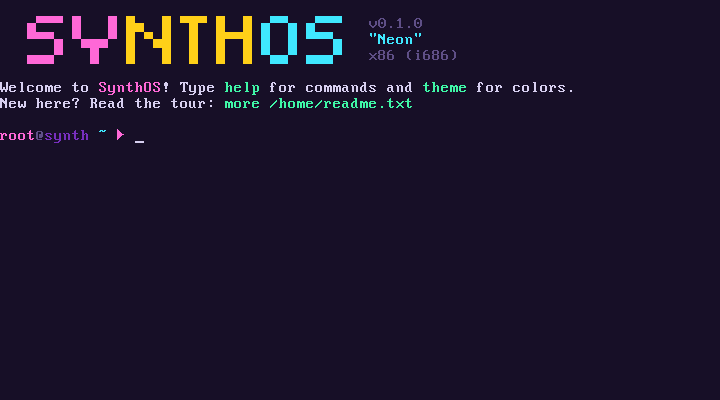

# SynthOS

**SynthOS** — операционная система, написанная с нуля: собственные загрузчики (BIOS и UEFI), ядро,
драйверы, **графический рабочий стол с окнами**, файловые системы, командная оболочка, виртуальная
машина для своих программ, эмулятор MS-DOS и **запуск программ Windows**. Никакого Linux, GRUB, Wine или чужих библиотек — один и тот же
образ загружается на старом ПК с BIOS (от i486 и 5 МБ ОЗУ), на современном ПК с UEFI или в QEMU.


## Возможности

| | |
|---|---|
| **Загрузка** | гибридный образ: свой MBR + stage2 для BIOS (LBA/CHS, E820/E801) и свой `BOOTX64.EFI` для UEFI (GOP, выход из long mode в 32-битный режим) |
| **Рабочий стол** | свой композитный оконный менеджер: тени, сглаженные шрифты и скругления, перетаскивание и изменение размера окон, развёртывание, панель задач с часами, меню «Пуск», значки, обои, Alt+Tab; мышь PS/2 с колёсиком; VBE (BIOS) и GOP (UEFI), от 640×480 до 1920×1200 и выше |
| **Приложения стола** | Терминал (вся оболочка в окне), Проводник (копирование, вставка, переименование, удаление, контекстные меню), Блокнот (выделение, буфер обмена, номера строк), Paint (кисти, фигуры, заливка, BMP), Калькулятор, Настройки (темы, обои, кодировка), Системный монитор (график памяти, диски, окна, журнал ядра), Сапёр |
| **Ядро** | 32-битное, от i486, страничная память, свой аллокатор, IDT/PIC/PIT, своя мини-libc, журнал `dmesg`, kernel panic |
| **Драйверы** | VGA-текст и графический фреймбуфер со своим шрифтом (кириллица CP866), PS/2, таймер, RTC, PC-speaker, COM-порт, PCI, диски IDE, **AHCI**, **NVMe** и любой диск через BIOS (USB-флешки) |
| **Windows** | загрузчик PE32 и свои kernel32, msvcrt, user32, advapi32, shell32, ntdll: консольные программы на C и C++ (STL, исключения), DLL, цвета консоли, MessageBox, `system()` |
| **Файлы** | VFS с точками монтирования, `ramfs`, `devfs`, **SynthFS** — своя ФС на диске (папка `/home` переживает перезагрузку); раскладка как в Windows: `C:\Windows\System32`, `C:\Program Files`, `C:\Users\root` |
| **Оболочка** | 86 команд (+ DOS-алиасы dir, copy, del, type, cls…), пайпы, перенаправления, переменные, `$(...)`, `if/while/for`, функции, алиасы, скрипты `.sh`, арифметика, пути `C:\…` |
| **Терминал** | подсветка синтаксиса прямо при вводе, автодополнение по Tab, подсказки из истории, статус-бар с часами |
| **Свои программы** | виртуальная машина **SX** (байт-код, работает на любом процессоре) + ассемблер `asm` и дизассемблер `dis` прямо в ОС |
| **MS-DOS** | эмулятор 8086/80186: `.COM` и `.EXE` (MZ), INT 21h/10h/16h/1Ah, прямая запись в видеопамять B800 |
| **Кастомизация** | 12 тем (+ свои файлы тем), 8 стилей приглашения и свой формат, перекраска любой части интерфейса, форма курсора, кодовые страницы 437/866 |
| **Приложения** | полноэкранный редактор `edit` с подсветкой, пейджер `more`, игра `snake`, `fetch`, бенчмарк |

| Меню «Пуск» и Paint | Приветствие в текстовом режиме |
|---|---|
|  |  |
| **Оболочка и `fetch`** | **Редактор `edit`** |
|  |  |
| **Темы, статус-бар, стиль приглашения** | **DOS-программа рисует в видеопамять** |
|  |  |
| **Программы Windows и MessageBox** | **Загрузка через UEFI, графическая консоль** |
|  |  |

## Быстрый старт

Нужны: `gcc` (или кросс-компилятор `i686-elf-gcc`), `binutils`, `nasm`, `make`, `qemu-system-x86`;
по желанию `mingw-w64` (примеры Windows-программ, UEFI-загрузчик), `dosfstools` + `mtools`
(раздел UEFI в образе), `ovmf` (UEFI в QEMU).

```sh
make            # собрать загрузочный образ build/vga/synthos.img (BIOS + UEFI)
make run        # запустить в QEMU как ПК с BIOS
make run-uefi   # запустить в QEMU как ПК с UEFI
make test       # собрать вариант с консолью на COM-порту и прогнать автотесты
make test-hw    # прогнать на 8 конфигурациях железа
```

Запуск на реальном ПК: записать `build/vga/synthos.img` на флешку побайтно
(`dd if=build/vga/synthos.img of=/dev/sdX bs=1M` или Rufus в режиме DD) и загрузиться с неё —
подходит и UEFI (с выключенным Secure Boot), и Legacy BIOS/CSM.

Подробная инструкция по установке инструментов, сборке, запуску и развитию проекта —
в **[INSTRUCTIONS.md](INSTRUCTIONS.md)**. Устройство системы — в
**[docs/ARCHITECTURE.md](docs/ARCHITECTURE.md)**.

## Первые команды

После загрузки открывается рабочий стол: значки слева, меню «Пуск» — кнопка в углу или клавиша Win,
окно «Терминал» — обычная оболочка. Команды можно набирать там:

```text
launch                    список приложений; launch paint, launch files /home, launch mines
desktop off; config save  загружаться сразу в текстовый режим (обратно — desktop on)
help                      все команды по категориям; help <команда> — подробно
more /home/readme.txt     экскурсия по системе
theme dracula             сменить тему (theme — список)
prompt twoline            стиль приглашения (prompt — все стили вживую)
config statusbar on       статус-бар; config save — запомнить настройки
snake                     игра на виртуальной машине SX
asm /home/src/hello.sasm  собрать свою программу
hello.com                 запустить DOS-программу
winhello, wincpp          запустить программы Windows (C:\Program Files = /apps)
cd "C:\Users\root"        пути Windows работают прямо в оболочке
config codepage 866       кириллица
edit /home/.synthrc       свой стартовый скрипт
```

## Структура

```text
arch/x86/          всё, что зависит от железа: загрузчики BIOS и UEFI, прерывания, страницы, драйверы
include/synth/     публичные заголовки ядра
kernel/core/       консоль, темы, ввод, потоки, блочные устройства, время, журнал
kernel/lib/        своя libc: строки, printf, пути
kernel/mm/         аллокатор памяти
kernel/fs/         VFS, ramfs, devfs, SynthFS, распаковка ramdisk
kernel/shell/      оболочка: разбор, исполнение, скрипты, редактор строки, промпт, настройки
kernel/cmds/       встроенные команды
kernel/apps/       полноэкранные приложения (edit, more)
kernel/gui/        рабочий стол: графика, оконный менеджер, виджеты, терминал; apps/ — приложения
kernel/exec/       загрузка программ и реестр форматов
kernel/vm/         виртуальная машина SX, ассемблер, дизассемблер
kernel/dos/        эмулятор MS-DOS (CPU 8086/186, DOS, BIOS)
kernel/win32/      подсистема Windows: загрузчик PE, kernel32, user32 …, crt/ — msvcrt
programs/          исходники программ, которые попадают в образ (SX, DOS, Windows)
rootfs/            файлы корневой ФС (конфиги, темы, документация)
tools/             утилиты для сборки (упаковщик ramdisk, ассемблер SX, генераторы шрифтов и значков)
tests/             автотесты и скрипт снятия скриншотов
```
