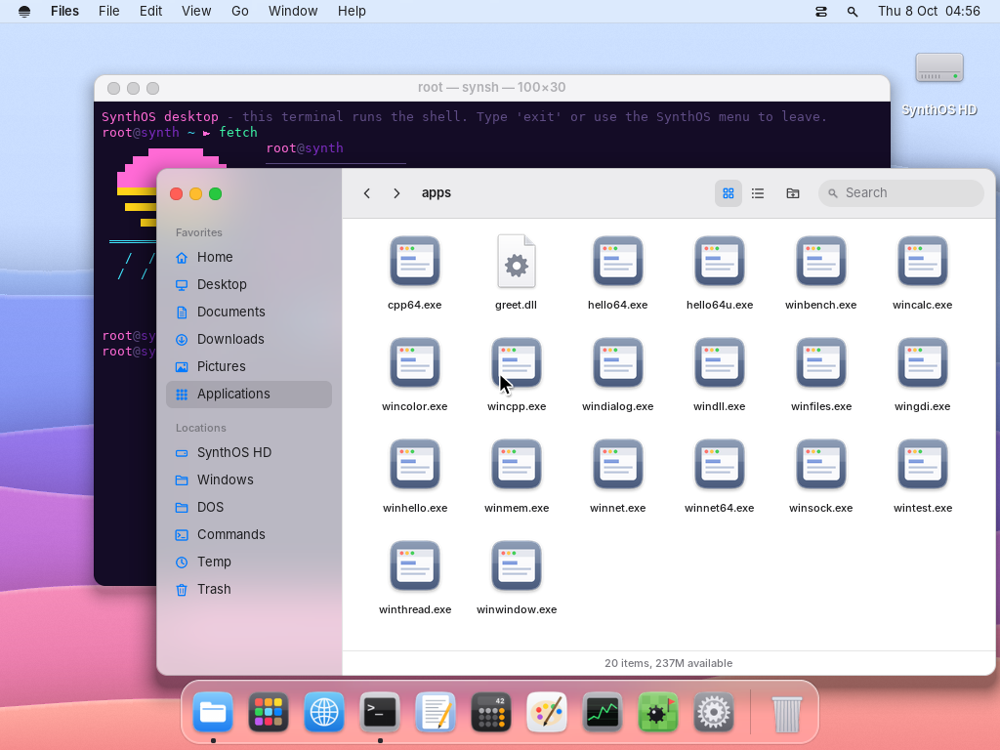
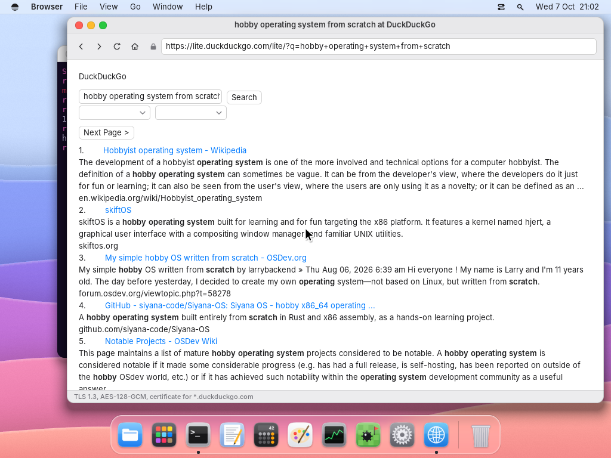
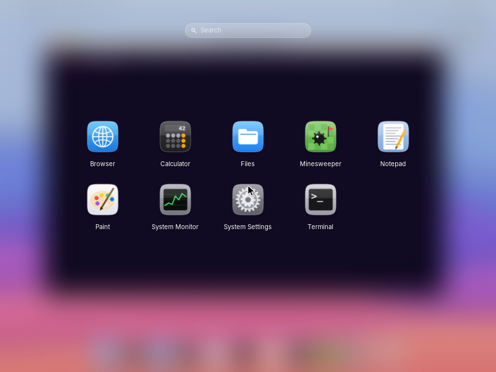
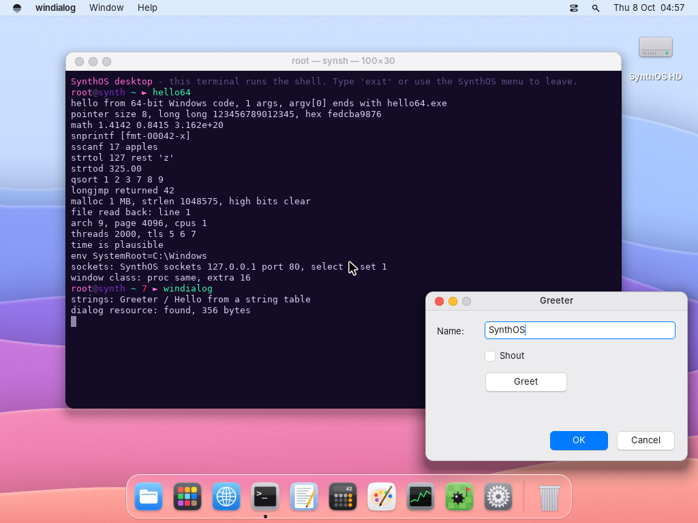
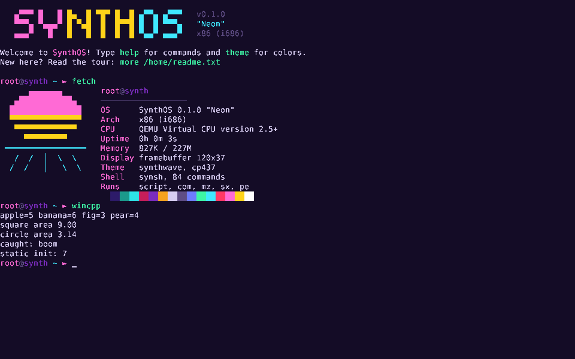
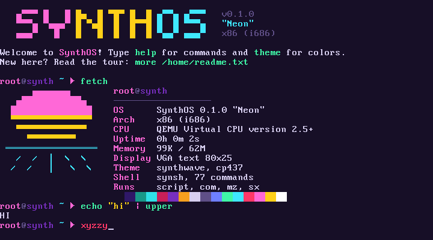
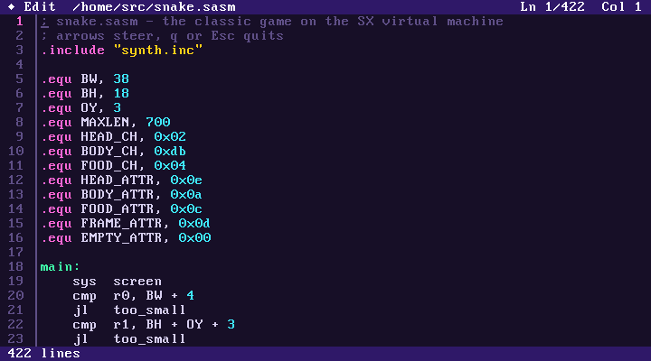
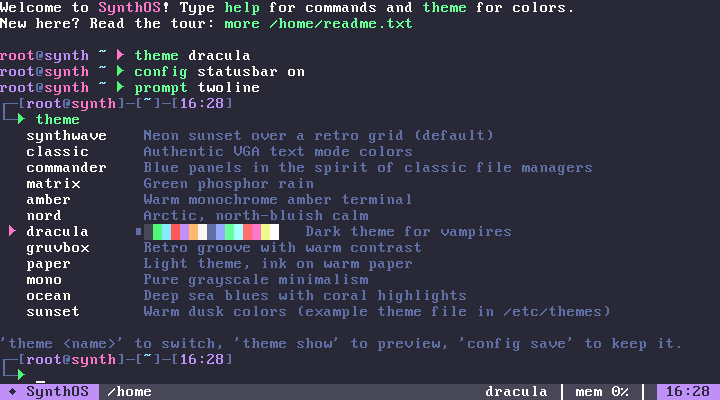
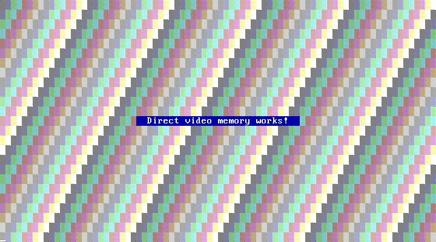

# SynthOS

**SynthOS** — операционная система, написанная с нуля: собственные загрузчики (BIOS и UEFI), ядро,
драйверы, **рабочий стол в стиле macOS**, файловые системы, сеть с **HTTPS** и **браузером**,
командная оболочка, виртуальная машина для своих программ, эмулятор MS-DOS и **запуск программ
Windows — 32- и 64-битных, консольных и оконных**. Никакого Linux, GRUB, Wine или чужих библиотек:
один и тот же образ загружается на старом ПК с BIOS (от i486), на современном ПК с UEFI или в QEMU.



## Возможности

| | |
|---|---|
| **Загрузка** | гибридный образ: свой MBR + stage2 для BIOS (LBA/CHS, E820/E801) и свой `BOOTX64.EFI` для UEFI (GOP, выход из long mode в 32-битный режим) |
| **Рабочий стол** | композитный оконный менеджер со строкой меню, Dock, Launchpad, поиском (Ctrl+Space), «стеклом» с размытием, тенями, сглаженными шрифтами Inter; вход по паролю и экран блокировки; несколько мониторов с разными разрешениями; мышь PS/2 и USB |
| **Приложения стола** | Браузер, Терминал, Файлы, Блокнот, Paint, Калькулятор, Системный монитор, Сапёр, Системные настройки (оформление, обои, Dock, мониторы, сеть, пользователи, блокировка, терминал, мышь) |
| **Ядро** | 32-битное, от i486; страничная память, **PAE** (ОЗУ и устройства выше 4 ГБ), **long mode** для 64-битных программ; свой аллокатор и мини-libc; сэмплирующий профилировщик `prof` |
| **Драйверы** | VGA и фреймбуфер (VBE/GOP), PS/2, **USB** (xHCI, хабы, клавиатуры, мыши, флешки), диски IDE (**DMA**), **AHCI**, **NVMe** и любой диск через BIOS; сеть **e1000/e1000e, RTL8139, RTL8169**; PCI, RTC, PC-speaker, COM-порт |
| **Сеть и интернет** | свой стек TCP/IP, DHCP, DNS; **TLS 1.3 и 1.2** с проверкой сертификатов (корни Mozilla), HTTP/HTTPS-клиент с редиректами и cookies; `wget`, `browse`, `ping`, `httpd`; графический **Браузер** со ссылками, формами и поиском |
| **Windows** | загрузчик PE32 и **PE32+**, свои kernel32, user32, gdi32, msvcrt, **UCRT**, ws2_32, **wininet, winhttp, urlmon**, advapi32, shell32, ntdll: консольные и **оконные** программы, диалоги из ресурсов, потоки, сокеты, HTTPS, C++ с исключениями (в том числе x64 SEH) |
| **Файлы** | VFS, `ramfs`, `devfs`, **SynthFS** (`/home` переживает перезагрузку), **FAT12/16/32** (флешки, разделы Windows); раскладка как в Windows: `C:\Program Files`, `C:\Users\root` |
| **Оболочка** | 108 команд (+ DOS-алиасы), пайпы, перенаправления, переменные, `$(...)`, `if/while/for`, функции, скрипты `.sh`; подсветка синтаксиса, автодополнение, подсказки из истории |
| **Свои программы** | виртуальная машина **SX** (байт-код) + ассемблер `asm` и дизассемблер `dis` прямо в ОС |
| **MS-DOS** | эмулятор 8086/80186: `.COM` и `.EXE` (MZ), INT 21h/10h/16h/1Ah, видеопамять B800 |
| **Пользователи** | учётные записи с паролями, `useradd`, `passwd`, `su`, `lock`; свой `/home` у каждого |

| **Браузер: поиск в интернете по HTTPS** | **Launchpad** |
|---|---|
|  |  |
| **64-битная программа и диалог Windows** | **Загрузка через UEFI, графическая консоль** |
|  |  |
| **Оболочка и `fetch`** | **Редактор `edit`** |
|  |  |
| **Темы, статус-бар, стиль приглашения** | **DOS-программа рисует в видеопамять** |
|  |  |

## Быстрый старт

Нужны: `gcc` (или кросс-компилятор `i686-elf-gcc`), `binutils`, `nasm`, `make`, `qemu-system-x86`;
по желанию `mingw-w64` (примеры Windows-программ, UEFI-загрузчик), `dosfstools` + `mtools`
(раздел UEFI в образе), `ovmf` (UEFI в QEMU), `openssl` и `python3` (тесты HTTPS).

```sh
make              # собрать загрузочный образ build/vga/synthos.img (BIOS + UEFI)
make usb          # образ для флешки build/synthos-usb.img (Rufus в режиме DD, balenaEtcher, dd)
make run          # запустить в QEMU как ПК с BIOS (с сетевой картой)
make run-uefi     # запустить в QEMU как ПК с UEFI
make test         # вариант с консолью на COM-порту + 250 автотестов
make test-hw      # BIOS/UEFI × IDE/AHCI/NVMe/USB и i486
make test-crypto  # криптография против эталонных векторов
```

Запуск на реальном ПК: `make usb`, записать `build/synthos-usb.img` на флешку побайтно
(Rufus в режиме DD, balenaEtcher или `dd`) и загрузиться с неё — подходит и UEFI (с выключенным
Secure Boot), и Legacy BIOS/CSM. С флешки можно работать сразу или установить систему на диск:
рядом с Windows в свободное место, вместо ненужного раздела или на весь диск, с меню выбора системы
при включении и мастером первого запуска — пошагово в **[docs/INSTALL.md](docs/INSTALL.md)**.

Подробная инструкция по установке инструментов, сборке, запуску и развитию проекта —
в **[INSTRUCTIONS.md](INSTRUCTIONS.md)**. Устройство системы — в
**[docs/ARCHITECTURE.md](docs/ARCHITECTURE.md)**.

## Первые команды

После загрузки открывается рабочий стол: внизу Dock, вверху строка меню, Launchpad — клавиша Win,
поиск — Ctrl+Space. Окно «Терминал» — обычная оболочка:

```text
launch browser            браузер; launch browser https://example.com
browse https://example.com    та же страница текстом прямо в терминале
wget -O - https://…       скачать файл (HTTPS с проверкой сертификата)
ifconfig, ping, nslookup  сеть (адрес выдаётся по DHCP автоматически)
winhello, wincpp, hello64 программы Windows (C:\Program Files = /apps)
windialog, wingdi         оконные программы Windows на рабочем столе
help                      все команды по категориям; help <команда> — подробно
more /home/readme.txt     экскурсия по системе
theme dracula             сменить тему (theme — список)
snake                     игра на виртуальной машине SX
hello.com                 запустить DOS-программу
cd "C:\Users\root"        пути Windows работают прямо в оболочке
```

## Скорость

Всё измерено в QEMU встроенными инструментами (`time`, `prof`, `winbench`):

| | было | стало |
|---|---|---|
| запуск `winhello.exe` | 184 мс | 16 мс |
| запуск 64-битного `hello64.exe` | 232 мс | 62 мс |
| копирование 4 МБ на FAT-диск | 3.3 с | 0.1 с |
| `fwrite` 4 МБ из программы Windows | 1319 мс | 33 мс |
| `ReadFile` с FAT-диска | 6.7 МБ/с | 60 МБ/с |
| `strlen`/`memchr` | 699 мс | 286 мс |
| вывод в окно Терминала | 9 800 строк/с | 12 800 строк/с |

## Структура

```text
arch/x86/          всё, что зависит от железа: загрузчики, прерывания, страницы, long mode, драйверы
include/synth/     публичные заголовки ядра
kernel/core/       консоль, темы, ввод, пользователи, блочные устройства, время, журнал
kernel/lib/        своя libc: строки, printf, пути
kernel/mm/         аллокатор памяти
kernel/fs/         VFS, ramfs, devfs, SynthFS, FAT, автомонтирование
kernel/net/        TCP/IP, DHCP, DNS, сокеты, TLS, X.509, HTTP, HTML
kernel/crypto/     SHA-2, HMAC/HKDF, AES-GCM, ChaCha20-Poly1305, X25519, RSA, ECDSA P-256/384
kernel/shell/      оболочка: разбор, исполнение, скрипты, редактор строки, промпт, настройки
kernel/cmds/       встроенные команды
kernel/apps/       полноэкранные приложения (edit, more)
kernel/gui/        рабочий стол: графика, оконный менеджер, Dock, меню, виджеты; apps/ — приложения
kernel/exec/       загрузка программ и реестр форматов
kernel/vm/         виртуальная машина SX, ассемблер, дизассемблер
kernel/dos/        эмулятор MS-DOS
kernel/win32/      подсистема Windows: PE/PE32+, kernel32, user32, gdi32, сокеты, Win64; crt/ — msvcrt и UCRT
programs/          исходники программ, которые попадают в образ (SX, DOS, Windows 32/64)
rootfs/            файлы корневой ФС (конфиги, темы, сертификаты, документация)
tools/             утилиты сборки (ramdisk, ассемблер SX, шрифты, значки, сертификаты, профилировщик)
tests/             автотесты, матрица железа, проверка криптографии, скриншоты
```
