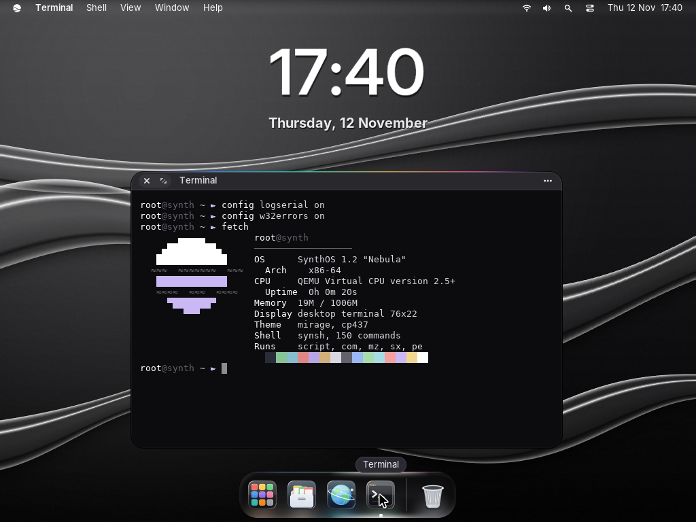
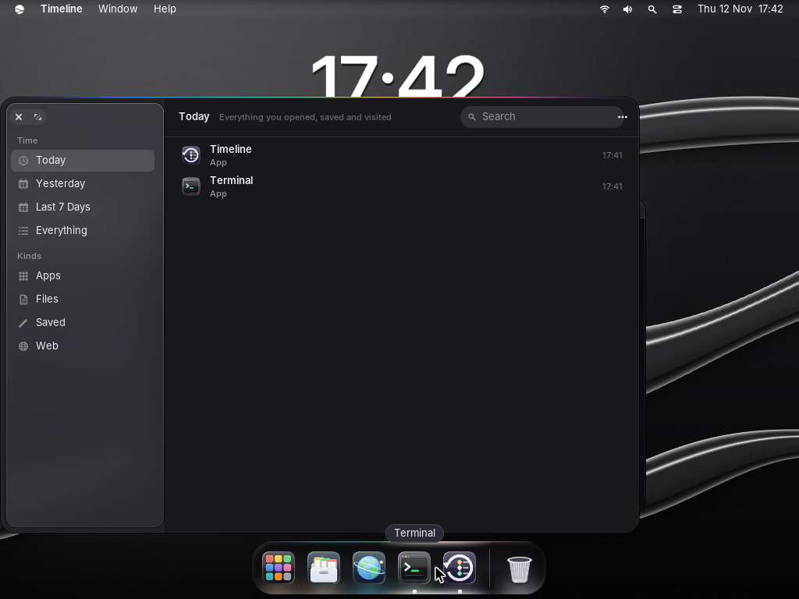
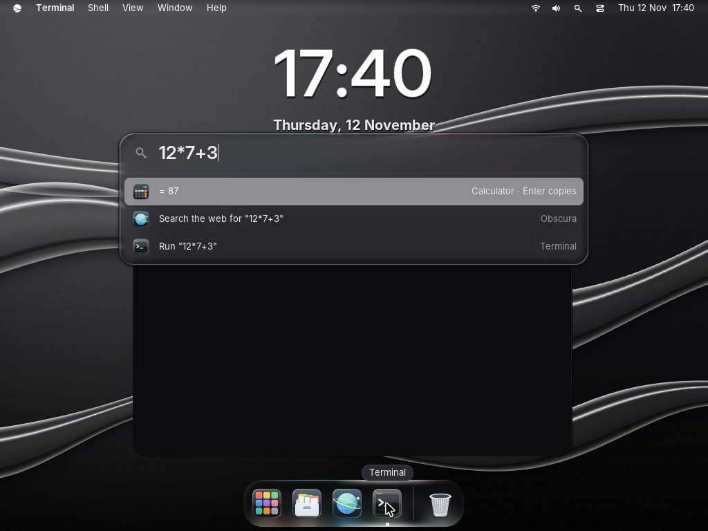
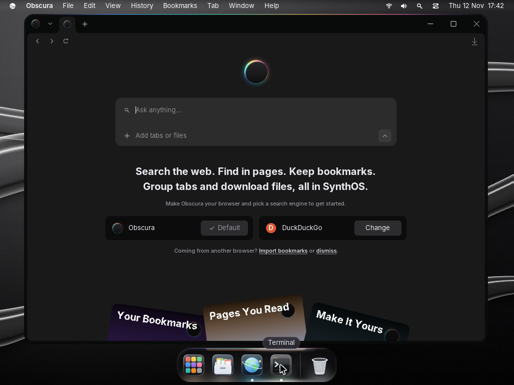
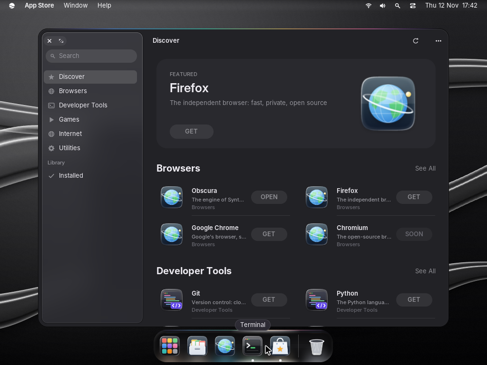
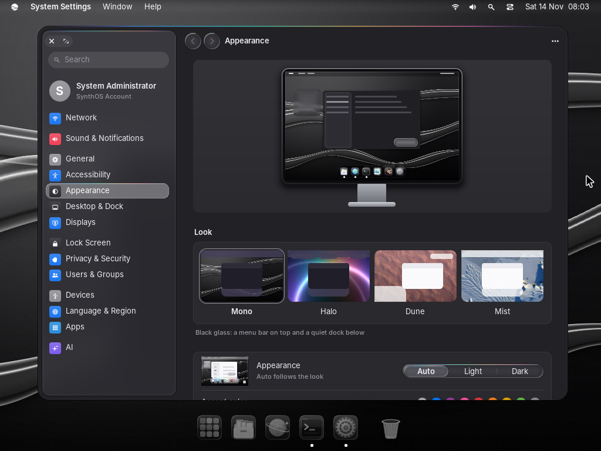
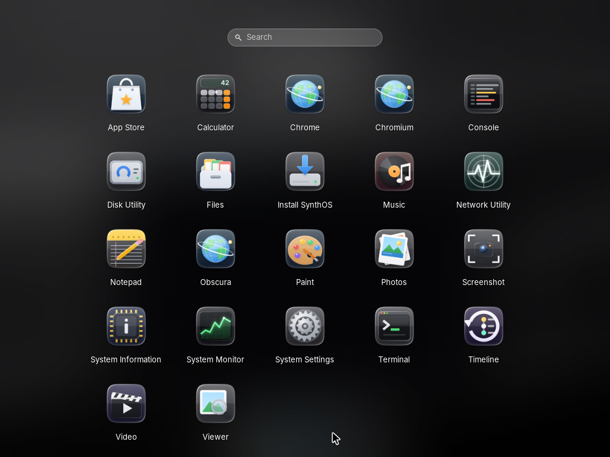
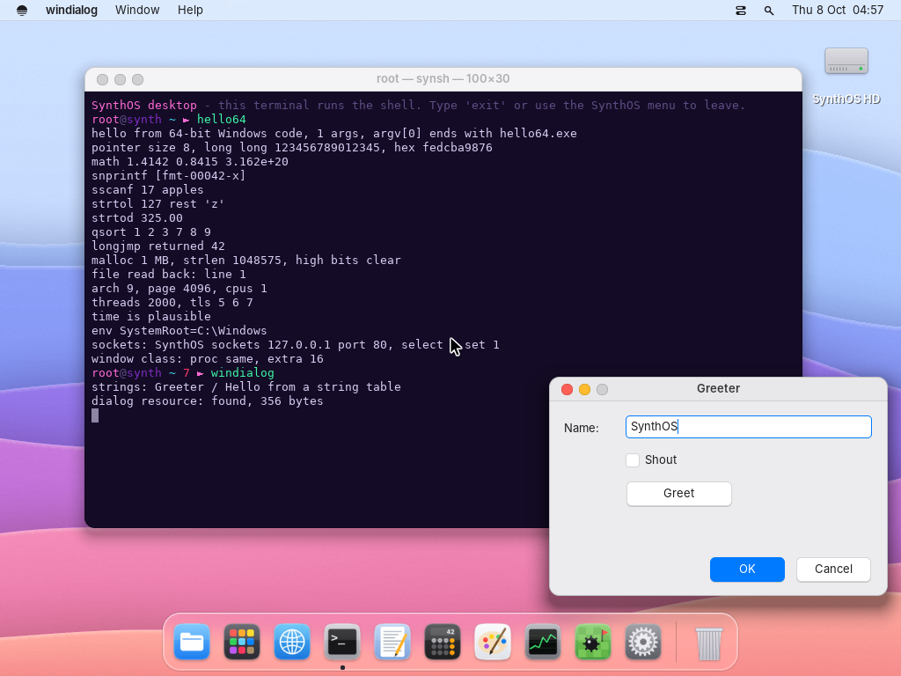
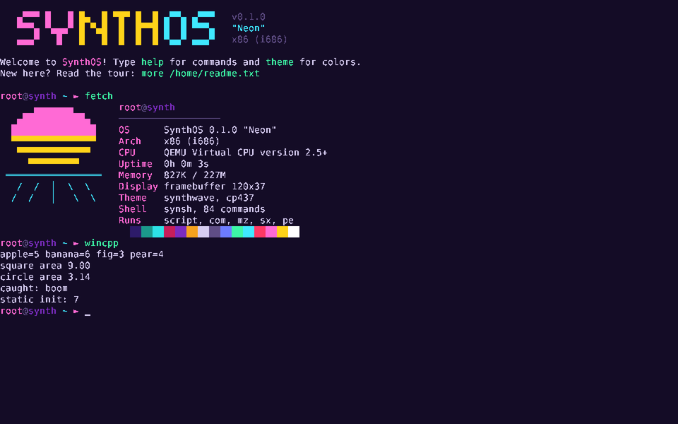

<div align="center">

# SynthOS

**Операционная система, написанная с нуля — и в ней можно жить.**

Свой загрузчик, своё ядро, свои драйверы, свой рабочий стол со «стеклом», свой браузер, магазин приложений —
и программы для Windows, которые запускаются без Wine и без Windows.

**Версия 1.2 «Nebula»** · 64-битное ядро · 32-битная сборка для ПК от i486 · BIOS и UEFI с Secure Boot

[**Скачать**](../../releases/latest) · [Установка](docs/INSTALL.md) · [Инструкция](INSTRUCTIONS.md) ·
[Устройство](docs/ARCHITECTURE.md)



</div>

## Почему SynthOS

- **Всё своё, с первой строки.** Никакого Linux, GRUB, Wine, libc или чужих библиотек: загрузчики BIOS и UEFI,
  ядро, файловые системы, TCP/IP, TLS 1.3, оконный менеджер, шрифты — всё написано для этого проекта.
- **Выглядит и ощущается как современная система.** Строка меню, Dock, Launchpad, Spotlight, Mission Control
  с несколькими рабочими столами, Liquid Glass с размытием и преломлением — у Dock, меню, виджетов и у каждой
  кнопки, переключателя и ползунка, — тёмная и светлая темы, анимации, виджеты, экран блокировки. В Настройках
  каждая панель и каждая настройка внешнего вида показывают живую картинку системы «до» и «после». Рабочий
  стол рисуют все ядра процессора.
- **ИИ внутри системы, без облака.** Локальная модель в «капле» под строкой меню: голос и текст, автодополнение
  по Tab во всех полях, управление любым окном и страницами браузера (с их JavaScript) через текстовый режим.
- **Запускает программы Windows.** 32- и 64-битные, консольные и оконные: свои kernel32, user32, gdi32,
  msvcrt/UCRT, сокеты, HTTPS, COM, реестр. Из магазина ставятся Firefox, Steam, Git, Python, 7-Zip и ещё десятки
  программ.
- **Ставится рядом с Windows за пять минут.** Из самой Windows, без флешки и без изменения настроек BIOS;
  Secure Boot остаётся включённым. Меню выбора системы при включении, мастер первого запуска, обновления по сети.
- **Возможности, которых нет у других.** Rewind, Timeline, отмена любой настройки, Focus и правила
  «когда — сделай» встроены в саму систему (подробнее ниже).

## Пять возможностей, ради которых стоит попробовать

| | |
|---|---|
| **Rewind** | каждый перезаписанный файл в `/home` сохраняет прошлые версии — откат одной командой `rewind` или из «Файлов» (правый клик → *Earlier Versions…*) |
| **Timeline** | лента всего, что вы открывали, сохраняли и посещали в сети: по дням, по видам, с поиском и возвратом версий |
| **Отмена настроек** | любое изменение настроек можно отменить — `config undo` или «Undo Last Setting Change» в Spotlight |
| **Focus** | тишина уведомлений, скрытый Dock, отсчёт в строке меню и блокировка отвлекающих приложений: `focus 25 block Obscura` |
| **Правила «когда — сделай»** | `when add at 09:00 -- launch notes`; по времени, при сохранении в папку, при входе, при запуске, при открытии приложения |

| **Timeline** | **Spotlight: калькулятор, поиск, команды** |
|---|---|
|  |  |

## Что внутри

| | |
|---|---|
| **Рабочий стол** | композитный оконный менеджер, строка меню, Dock со сном, Launchpad, Spotlight (Ctrl+Space: приложения, файлы, настройки, калькулятор, адреса, действия системы), Mission Control и Spaces, Control Center, виджеты, уведомления, несколько мониторов, сочетания клавиш как в Windows или как в macOS на выбор |
| **Приложения** | браузер Obscura, Терминал, Файлы (в том числе с путями `C:\`), Настройки, App Store, Timeline, Блокнот, Paint, Калькулятор, Фото, Видео, Музыка, Скриншот, Системный монитор, Дисковая утилита, Установщик; из магазина — Часы, Погода, Заметки, Сапёр |
| **Браузер Obscura** | кнопки окна как в системе слева и одно меню «⋯», вкладки-значки или сбоку, стартовая страница с логотипом SynthOS и поиском (в том числе только по выбранным сайтам), настройки по разделам, группы и закрепление вкладок, разделение окна на две страницы, режим фокуса, частный режим, профили, закладки с импортом, история, загрузки; движок — Obscura (Rust + V8) |
| **App Store** | 60 с лишним приложений: браузеры, инструменты разработчика, игры, утилиты; установка, обновления, удаление |
| **Windows** | PE32 и PE32+, консольные и оконные программы, диалоги из ресурсов, потоки, сокеты, WinINet/WinHTTP, C++ с исключениями (включая x64 SEH), COM, реестр, буфер обмена с картинками |
| **Ядро** | x86-64 со всеми ядрами процессора (APIC, x2APIC), своё адресное пространство у каждой программы; 32-битная сборка с PAE для старых ПК; самовосстановление после неудачных стартов |
| **Драйверы** | фреймбуфер VBE/GOP, PS/2, USB (xHCI, хабы, клавиатуры, мыши, флешки), IDE с DMA, AHCI, NVMe, сеть e1000/e1000e, RTL8139, RTL8169, звук |
| **Сеть** | свой TCP/IP, DHCP, DNS, TLS 1.3 и 1.2 с проверкой сертификатов (корни Mozilla), HTTP/HTTPS с cookies и редиректами |
| **Файлы** | VFS, SynthFS (длинные имена, переживает перезагрузку), FAT12/16/32, ramfs, devfs; раскладка как в Windows: `C:\Program Files`, `C:\Users` |
| **Установка** | установщик с разметкой (рядом с Windows, вместо раздела, на весь диск), меню выбора системы с настройкой (что запускать, сколько ждать, что скрыть), мастер первого запуска из 9 шагов, обновления по сети |
| **Оболочка** | 150 команд, пайпы, перенаправления, `$(...)`, `if/while/for`, функции, скрипты; подсветка синтаксиса, автодополнение, подсказки из истории |
| **Ещё** | виртуальная машина SX с ассемблером, эмулятор MS-DOS, пользователи с паролями, профилировщик `prof` |

| **Браузер Obscura** | **App Store** |
|---|---|
|  |  |
| **Системные настройки** | **Launchpad** |
|  |  |
| **64-битная программа Windows** | **Загрузка через UEFI** |
|  |  |

## Установить

Ничего собирать не нужно — в [последнем выпуске](../../releases/latest) лежат готовые файлы:

| Файл | Для чего |
|---|---|
| `synthos-windows.zip` | установка из Windows без флешки: распаковать, запустить `Install SynthOS.cmd`, перезагрузиться |
| `synthos-usb.zip` | образ для флешки (Rufus в режиме DD, balenaEtcher, `dd`): работать с флешки или установить на диск |
| `synthos-usb32.zip` | 32-битная система для старых ПК |

Настройки BIOS/UEFI менять не нужно: Secure Boot остаётся включённым (первый запуск — через shim с подписью
Microsoft и один экран MokManager), SATA может быть в режиме «RAID / Intel RST». Пошагово, со скриншотами —
в **[docs/INSTALL.md](docs/INSTALL.md)**.

## Собрать самому

Нужны `gcc`, `binutils`, `nasm`, `make`, `qemu-system-x86`; по желанию `clang`, `mingw-w64` (программы Windows,
UEFI-загрузчик), `dosfstools` + `mtools` (раздел UEFI), `ovmf` (UEFI в QEMU), `openssl` и `python3`
(тесты HTTPS).

```sh
make              # загрузочный образ build/vga/synthos.img (BIOS + UEFI)
make run          # запустить в QEMU (make run-uefi — как ПК с UEFI)
make usb          # образ для флешки build/synthos-usb.img
make windows      # build/synthos-windows.zip — установка из Windows
make ARCH=i686    # 32-битная сборка для старых ПК
make test         # более 500 автотестов в QEMU (обе сборки проходят их полностью)
make test-hw      # BIOS/UEFI × IDE/AHCI/NVMe/USB/xHCI и установка рядом с Windows
```

Как всё устроено и как расширять систему — в **[INSTRUCTIONS.md](INSTRUCTIONS.md)** и
**[docs/ARCHITECTURE.md](docs/ARCHITECTURE.md)**. Чего пока нет по сравнению с Windows и macOS —
в **[docs/GAPS.md](docs/GAPS.md)**.

## Первые шаги

После загрузки открывается рабочий стол: Launchpad — клавиша Win, поиск — Ctrl+Space, Терминал — в Dock.

```text
launch obscura             браузер (адрес можно ввести и в Spotlight)
store list                 магазин приложений из терминала
rewind ~/notes.txt         прошлые версии файла
timeline                   что вы открывали и сохраняли сегодня
focus 25 block Obscura     25 минут без отвлечений
when add at 09:00 -- launch notes
config undo                отменить последнее изменение настроек
winhello, hello64, windialog   программы Windows
help                       все команды; help <команда> — подробно
```

## Скорость

Измерено в QEMU встроенными инструментами (`time`, `prof`, `winbench`, `appbench`):

| | было | стало |
|---|---|---|
| открытие Настроек | 451 мс | 94 мс |
| открытие Системного монитора | 166 мс | 8 мс |
| `winbench` (программы Windows, `/tmp`) | 7.7 с | 2.9 с |
| запуск `winhello.exe` | 184 мс | 16 мс |
| копирование 4 МБ на FAT-диск | 3.3 с | 0.1 с |
| `ReadFile` с FAT-диска | 6.7 МБ/с | 60 МБ/с |

## Структура

```text
arch/x86/          загрузчики, прерывания, страницы, long mode, драйверы — всё, что зависит от железа
kernel/core/       консоль, ввод, пользователи, установка, обновления, Timeline, правила
kernel/fs/         VFS, SynthFS, FAT, ramfs, devfs, версии файлов
kernel/net/        TCP/IP, DHCP, DNS, TLS, X.509, HTTP, HTML
kernel/crypto/     SHA-2, AES-GCM, ChaCha20-Poly1305, X25519, RSA, ECDSA
kernel/gui/        графика, оконный менеджер, Dock, меню, виджеты; apps/ и optional/ — приложения
kernel/win32/      подсистема Windows: PE/PE32+, kernel32, user32, gdi32, Win64; crt/ — msvcrt и UCRT
kernel/shell/      оболочка; kernel/cmds/ — встроенные команды
kernel/vm/, dos/   виртуальная машина SX и эмулятор MS-DOS
programs/, rootfs/ программы и файлы, которые попадают в образ
tools/, tests/     утилиты сборки, автотесты, матрица железа, скриншоты
```

Лицензии сторонних шрифтов, обоев и движка браузера — в [docs/LICENSES.md](docs/LICENSES.md).
