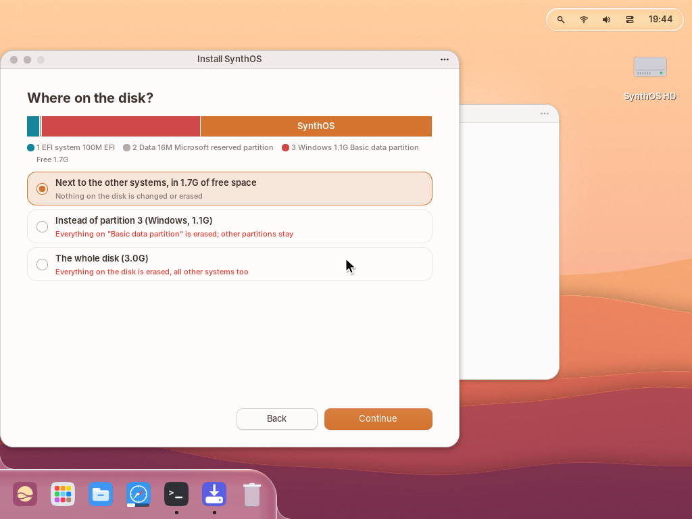
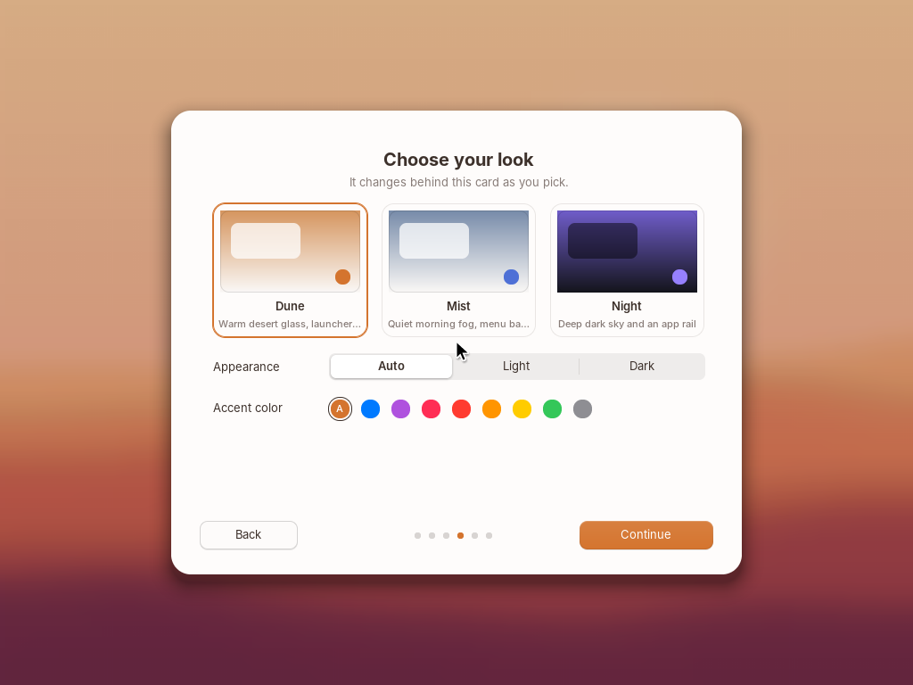

# Установка SynthOS на компьютер

Коротко: записать образ на флешку → загрузиться с неё → «Install SynthOS» → выбрать, куда
ставить → перезагрузиться (флешку пока не вынимать) → ответить на вопросы мастера первого
запуска. Ниже — подробно.

| **Установщик: карта диска и выбор места** | **Мастер первого запуска** |
|---|---|
|  |  |

## 1. Загрузочная флешка

Нужна флешка от 1 ГБ (всё, что на ней было, сотрётся).

1. Собрать образ для флешки:

   ```sh
   make usb        # build/synthos-usb.img и build/synthos-usb.img.sha256
   ```

   Он компактный (система, Chromium и 64 МБ под данные); при первом запуске раздел данных сам
   растягивается на всю флешку, так что флешку можно использовать как «живую» систему со своими
   файлами.

2. Записать образ **побайтно**:
   * **Windows** — [Rufus](https://rufus.ie): «Устройство» — флешка, «Метод загрузки» — выбрать
     `synthos-usb.img`; на вопрос о режиме записи ответить **DD-образ**. Или
     [balenaEtcher](https://etcher.balena.io): Flash from file → флешка → Flash.
   * **macOS** — balenaEtcher, или в терминале:
     `diskutil list`, `diskutil unmountDisk /dev/diskN`,
     `sudo dd if=build/synthos-usb.img of=/dev/rdiskN bs=1m`.
   * **Linux / WSL** — `lsblk`, затем
     `sudo dd if=build/synthos-usb.img of=/dev/sdX bs=4M status=progress conv=fsync`
     (sdX — именно флешка, не системный диск!).

## 2. Настройки прошивки (BIOS/UEFI) — один раз

Зайти в настройки сразу после включения (обычно Del, F2, F10 или Esc):

* **Secure Boot** — либо выключить, либо оставить включённым и добавить ключ SynthOS (ниже);
* режим загрузки — **UEFI** (для установки рядом с Windows он обязателен; старый режим
  Legacy/CSM подходит только для установки на весь диск);
* режим SATA — **AHCI** (не RAID/Intel RST), иначе SynthOS не увидит диск;
* «Fast Boot» лучше выключить, чтобы прошивка видела флешку.

**BitLocker.** Если диск Windows зашифрован (на ноутбуках с Windows 11 это часто включено само),
выключение Secure Boot приведёт к запросу ключа восстановления при следующем запуске Windows.
Перед тем как менять настройки прошивки, в Windows сохраните ключ
(account.microsoft.com/devices/recoverykey) или приостановите защиту:
`manage-bde -protectors -disable C: -RebootCount 3` (командная строка от администратора).

**Secure Boot без выключения.** Загрузчик SynthOS подписан ключом, который создаётся при сборке
(`keys/db.key`), а не ключом Microsoft, поэтому прошивка запустит его, только когда этот ключ добавлен в
её список разрешённых (db). Сертификат лежит на флешке: `SYNTHOS\SYNTHOS.CER`.

1. В настройках прошивки открыть Secure Boot → управление ключами (Key Management; иногда сначала
   нужно переключить режим на Custom/User).
2. В разделе **db** (Authorized Signatures) выбрать «Append/Enroll from file» (не «Replace»!) и
   указать `SYNTHOS\SYNTHOS.CER` на флешке. Ключи Microsoft остаются — Windows грузится как прежде.
3. Сохранить настройки (F10) и загрузиться с флешки.

Если такого пункта нет, Secure Boot придётся выключить. Изменение списка ключей, как и выключение
Secure Boot, BitLocker тоже замечает — сначала сохраните ключ восстановления (см. выше).
При включённом Secure Boot загрузчик запускает только то ядро, с которым он был подписан.

## 3. Загрузка с флешки

Вставить флешку, перезагрузить компьютер и выбрать её в меню загрузки (обычно F12, F11, F8 или Esc
сразу после включения). Появится экран «Welcome to SynthOS»:

* **Try SynthOS** — работать прямо с флешки, ничего на компьютере не меняя;
* **Install SynthOS** — открыть установщик (он же есть в Dock и в Launchpad).

## 4. Установщик

1. **Which disk?** — выбрать диск (флешка, с которой идёт загрузка, в списке не показывается).
2. **Where on the disk?** — сверху карта диска: каждый раздел в масштабе, с типом, размером и
   меткой. Варианты:
   * **Next to the other systems, in N GB of free space** — в неразмеченное место; ни один
     существующий раздел не меняется. Это вариант «рядом с Windows».
   * **Instead of partition N** — удалить выбранный раздел (например, ненужный диск D:) и
     поставить SynthOS на его место; остальные разделы не трогаются. Раздел EFI и служебный
     раздел Microsoft (MSR) заменить нельзя.
   * **The whole disk** — стереть весь диск и отдать его SynthOS.

   **Как выделить место от раздела Windows.** SynthOS сам не уменьшает раздел NTFS — это
   надёжнее сделать средствами Windows: Win+X → «Управление дисками» → правой кнопкой по C: →
   «Сжать том» → указать, сколько МБ отдать (например, 30000 для 30 ГБ). Появится
   «Не распределено» — после перезагрузки с флешки установщик покажет это место как вариант
   «Next to the other systems». Если места не хватает, установщик сам подскажет это.
3. **How much space for SynthOS?** — ползунок (или кнопки Smallest / 16 GB / 64 GB / All, или
   стрелки ←/→ по 1 ГБ). Остаток свободного места остаётся свободным.
4. **Ready to install** — сводка: диск, куда, сколько места, что будет стёрто (красным, если
   что-то стирается). Переключатель «Bring my files and settings» переносит `/home` с флешки.
   Только кнопка **Install** / **Erase and Install** что-либо записывает.
5. Копирование (~1 минута) и **Restart**.

Что создаётся на диске при установке «рядом»:

| Раздел | Размер | Что внутри |
|---|---|---|
| SynthOS EFI (тип EFI System) | 4 МБ | загрузчик `\EFI\BOOT\BOOTX64.EFI`, ядро, `\SYNTHOS\SYSTEM.CFG` |
| SynthOS | остальное | загрузочная область, Chromium, раздел данных (`/home`) |

Раздел EFI Windows не изменяется — у SynthOS свой.

## 5. Первая перезагрузка и меню загрузки

После **Restart** оставьте флешку вставленной: загрузчик с флешки находит новую установку,
добавляет пункт **SynthOS** в меню загрузки компьютера (переменные UEFI `Boot####` и
`BootOrder`) и сразу запускает систему с диска. После этого флешку можно вынуть.

При каждом включении, если на компьютере есть другие системы, SynthOS показывает меню:

```
  SynthOS boot menu

  > SynthOS
    Windows Boot Manager

  Up and Down (or a number) choose, Enter starts.  SynthOS starts in 3 s.
```

Выбор Windows запускает её штатно — через прошивку (`BootNext` и перезапуск), а не изнутри
загрузчика SynthOS, поэтому BitLocker и обновления Windows ведут себя как обычно. Время ожидания —
строка `timeout=` в `\SYNTHOS\SYSTEM.CFG` на разделе SynthOS EFI (0 — без меню).

Если обновление Windows поставило свой пункт первым — выберите SynthOS в меню загрузки прошивки
(F12/F11/F8) или поднимите его в настройках UEFI (Boot Order).

## 6. Мастер первого запуска

При первом запуске установленной системы:

1. **Hello** — приветствие.
2. **Keyboard and region** — раскладки клавиатуры (English US всегда; Russian, German, French,
   Spanish), часовой пояс (←/→), 24-часовой формат. Интерфейс системы — на английском; печатать
   можно на любом выбранном языке.
3. **Your account** — имя, имя учётной записи (подставляется само: «Anna Smith» → `anna`),
   пароль (можно оставить пустым), «Log in automatically». Tab переходит между полями.
4. **Choose your look** — Dune / Mist / Night, светлый/тёмный режим, цвет акцента; рабочий стол
   за карточкой меняется сразу.
5. **Your web browser** — Chromium (уже установлен, работает без сети) или Google Chrome
   (скачивается и ставится при первом открытии).
6. **All set** → **Start** — создаётся учётная запись и выполняется вход.

Всё это потом меняется в System Settings; мастер можно запустить снова командой `welcome`.

**Раскладки.** Переключение — **Win+Space** или щелчок по буквам (EN/RU…) в строке состояния.
Набирать можно в полях приложений, в Блокноте и в Windows-программах; в Терминале команды
вводятся латиницей. Включить раскладки позже: System Settings → Keyboard → Input Sources или
`config keyboard us,ru`.

## 7. Из терминала

```
install                                   диски, их разделы и свободное место
install sda --free 1 --size 30000 --yes   в первое свободное место, 30 ГБ
install sda --replace 4 --yes             вместо раздела 4
install sda --whole --yes                 на весь диск
install ... --copy-home                   перенести /home
part [диск]                               таблица разделов (MBR/GPT)
part sdb init gpt --yes                   новая пустая таблица GPT
part sdb add 512 data Docs --yes          добавить раздел на 512 МБ
part sdb del 2 --yes                      удалить раздел 2
welcome                                   мастер первого запуска
```

## 8. Удаление SynthOS

В Windows: «Управление дисками» → удалить разделы «SynthOS» и «SynthOS EFI» (для раздела EFI
понадобится `diskpart`: `select disk N`, `select partition M`, `delete partition override`),
затем расширить соседний раздел. Пункт SynthOS в меню загрузки удаляется командой
`bcdedit /enum firmware` → `bcdedit /delete {идентификатор}` или в настройках UEFI.

## 9. Если что-то пошло не так

* **Флешка не видна в меню загрузки** — выключить Fast Boot; записать образ заново в режиме DD.
* **«Security violation» / «Access Denied» / ничего не происходит** — Secure Boot не знает ключа SynthOS:
  добавить `SYNTHOS\SYNTHOS.CER` в db (п. 2) или выключить Secure Boot.
* **«Secure Boot: KERNEL.BIN is not the kernel this loader was signed with»** — ядро на флешке
  заменено или повреждено: записать образ заново.
* **Установщик не видит диск** — режим SATA в прошивке переключить на AHCI.
* **Нет варианта «рядом с Windows»** — нет неразмеченного места нужного размера: сжать том в
  Windows (см. п. 4). Диски больше 2 ТБ с GPT пока доступны только целиком.
* **После установки грузится сразу Windows** — загрузиться один раз с флешкой (она добавит
  SynthOS в меню) или выбрать «SynthOS» в меню загрузки прошивки.
* **Компьютер в режиме Legacy BIOS** — установка «рядом» требует UEFI; на весь диск можно и в BIOS.
